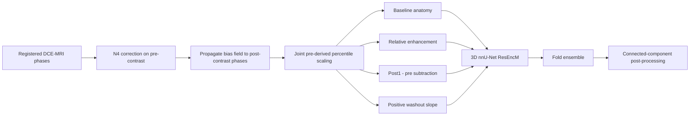
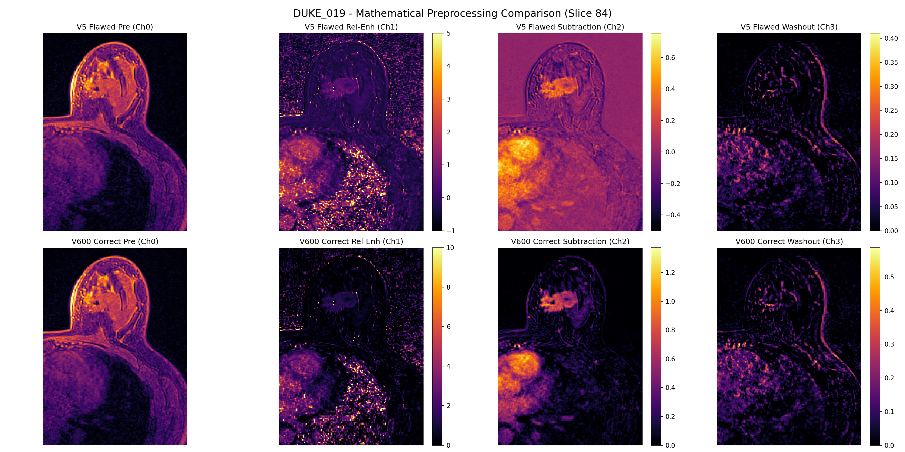

# Physics-Informed DCE-MRI Breast Tumor Segmentation

A portfolio-ready implementation of contrast-kinetics-informed 3D breast tumor segmentation using nnU-Net v2. The project converts registered dynamic contrast-enhanced MRI into four physically interpretable channels and trains a residual-encoder 3D nnU-Net across the multi-center MAMA-MIA benchmark.

> Research code only. This repository is not a medical device and must not be used for clinical decision-making.

## Why this project matters

Normalizing every DCE phase independently removes the intensity differences that encode contrast uptake and washout. Dataset600 fixes that failure mode by estimating percentile bounds from the pre-contrast image once and applying the same transform to every post-contrast phase.





## Evidence-backed results

The repository deliberately separates evaluation protocols. Metrics from different cohorts or model variants are not presented as directly interchangeable.

| Evaluation | Model/configuration | Cases | Dice | Notes |
|---|---|---:|---:|---|
| Internal 5-fold CV | Dataset600 TopKCE, ResEncM, 3D full resolution | 1,200 | **0.8013** | Out-of-fold aggregate from nnU-Net `summary.json` |
| Internal 5-fold CV | Dataset600 standard Dice+CE, 1,000 epochs | 1,200 | 0.7940 | Mean across five validation folds |
| Held-out MAMA-MIA challenge cohort | 3-fold probability ensemble | 306 | **0.7801** | Best recorded mean Dice among the audited challenge configurations before proximity PP |
| Held-out MAMA-MIA challenge cohort | 3-fold ensemble + proximity PP | 306 | **0.7810** | Highest recorded Dice; configuration selection means this is not an untouched final validation estimate |
| External YUN cohort | Dataset600 fold 0, 100 epochs, zero-shot | 98 | **0.8336** | Artifact-reported external evaluation; no YUN fine-tuning |
| External IEDH subset | Dataset600 fold 0, 100 epochs, zero-shot | 31 | 0.7281 | Median Dice 0.8258; missing late phase handled with a zero-filled washout channel |

The `ds600` checkpoints are the best-supported model family in the recovered local archive, but they are not committed here: each checkpoint is approximately 816 MB and a five-fold set is approximately 4.1 GB. See [MODEL_CARD.md](docs/MODEL_CARD.md) for provenance and release limitations.

## Repository layout

```text
assets/                 Non-identifying derived figures
configs/                nnU-Net dataset metadata and result manifest
docs/                   Model card, result audit, and data guidance
scripts/data/           Dataset600 generation and plan verification
scripts/inference/      Single- and multi-GPU inference
scripts/evaluation/     Extended and challenge metrics
scripts/postprocessing/ Connected-component refinement
src/dce_mri/            Small reusable, tested preprocessing core
tests/                  Synthetic unit tests (no medical data)
```

## Installation

Create a Python 3.10+ environment with PyTorch appropriate for your CUDA system, then install the remaining dependencies:

```bash
python -m pip install -r requirements.txt
```

nnU-Net v2 also requires `nnUNet_raw`, `nnUNet_preprocessed`, and `nnUNet_results` environment variables. Follow the official nnU-Net documentation for platform-specific setup.

## Reproduce the feature construction

The reusable core accepts already registered NumPy arrays:

```python
from dce_mri.features import compute_kinetic_channels

channels = compute_kinetic_channels(pre_contrast, post_contrast_series)
# channels.shape == (4, X, Y, Z)
```

To build an nnU-Net dataset from NIfTI data, edit paths through the CLI rather than source code:

```bash
python scripts/data/create_dataset_600.py \
  --source-aligned /path/to/registered/cases \
  --source-labels /path/to/training/labels \
  --source-jsons /path/to/roi/json \
  --split-csv /path/to/train_test_splits.csv \
  --nnunet-raw /path/to/nnUNet_raw
```

The input data are not redistributed. Obtain MAMA-MIA through its official access route and comply with its terms.

## Inference

```bash
python scripts/inference/predict_600.py \
  --input /path/to/case_folders \
  --batch \
  --model /path/to/nnUNet_results/Dataset600_MAMAMIAPhysics/model_folder \
  --folds 0 1 2 3 4 \
  --output predictions
```

The recovered scripts support JSON ROI crops, bilateral breast masks, multi-fold ensembling, and connected-component post-processing. Paths in commands are examples only.

## Tests

```bash
PYTHONPATH=src pytest -q
```

Tests use synthetic arrays and verify temporal normalization, enhancement channels, washout sign, and numerical stability.

## Data and privacy

This repository intentionally excludes:

- DICOM and NIfTI images, labels, predictions, and patient-level metadata;
- clinical spreadsheets and per-patient JSON files;
- training checkpoints and optimizer state;
- private institutional cohorts;
- copied papers and third-party source repositories.

See [DATA.md](docs/DATA.md) for the expected input organization.

## Status

This is a curated research snapshot reconstructed from the surviving local project archive after the original compute host became unavailable. Aggregate claims are linked to recovered result artifacts in [RESULTS.md](docs/RESULTS.md). Independent rerunning of the full training pipeline requires the source datasets and substantial GPU compute.

## Citation and license

Please cite MAMA-MIA, nnU-Net, and any dataset used in your experiment. A project-specific software license has not yet been selected; absent a license, normal copyright restrictions apply.
