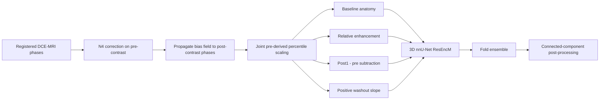
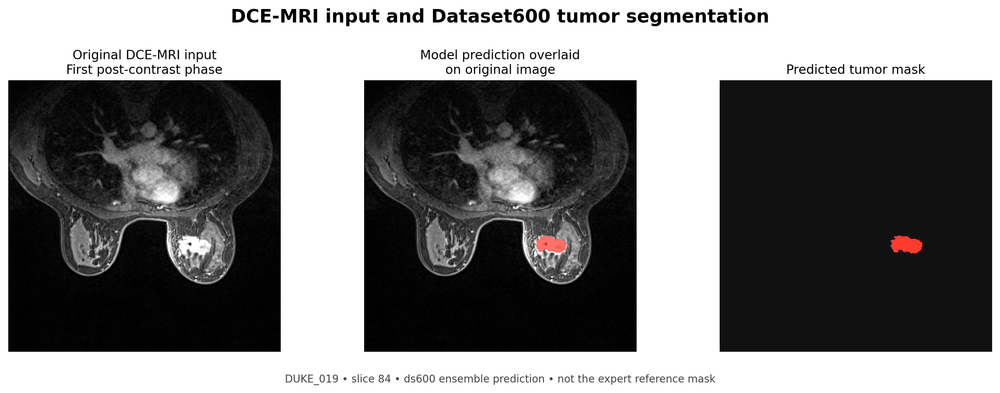

# Physics-Informed DCE-MRI Breast Tumor Segmentation

This repository contains code for 3D breast tumor segmentation from registered dynamic contrast-enhanced MRI (DCE-MRI). It constructs four input channels—pre-contrast anatomy, relative enhancement, post-contrast subtraction, and washout slope—and uses them to train a residual-encoder nnU-Net v2 on the multi-center MAMA-MIA dataset.

> Research code only. This repository is not a medical device and must not be used for clinical decision-making.

For feature construction, the code estimates percentile bounds from the pre-contrast image and applies the same scaling to the post-contrast phases. This keeps the phase scaling consistent when calculating enhancement channels.





This is a single-slice illustration from MAMA-MIA case DUKE_019 (slice 84), using the original first post-contrast phase and the recovered `ds600` ensemble prediction. The image component comes from the MAMA-MIA dataset, distributed under CC BY-NC 4.0 at the level of its most restrictive source collection. Cite [Garrucho et al. (MAMA-MIA)](https://doi.org/10.1038/s41597-025-04707-4) and [Saha et al. (Duke-Breast-Cancer-MRI)](https://doi.org/10.7937/TCIA.e3sv-re93). The red region is the model prediction, not the expert reference annotation.

## Reported results

Results are grouped by evaluation protocol. Values from different cohorts and model variants should not be compared directly.

| Evaluation | Model/configuration | Cases | Dice | Notes |
|---|---|---:|---:|---|
| Internal 5-fold CV | Dataset600 TopKCE, ResEncM, 3D full resolution | 1,200 | **0.8013** | Out-of-fold aggregate from nnU-Net `summary.json` |
| Internal 5-fold CV | Dataset600 standard Dice+CE, 1,000 epochs | 1,200 | 0.7940 | Mean across five validation folds |
| Held-out MAMA-MIA challenge cohort | 3-fold probability ensemble | 306 | **0.7801** | Recorded mean Dice before proximity post-processing |
| Held-out MAMA-MIA challenge cohort | 3-fold ensemble + proximity PP | 306 | **0.7810** | Highest Dice among the listed configurations; configuration selection means this is not an untouched final validation estimate |
| External YUN cohort | Dataset600 fold 0, 100 epochs, zero-shot | 98 | **0.8336** | Artifact-reported external evaluation; no YUN fine-tuning |
| External IEDH subset | Dataset600 fold 0, 100 epochs, zero-shot | 31 | 0.7281 | Median Dice 0.8258; missing late phase handled with a zero-filled washout channel |

The recovered archive contains `ds600` checkpoints, but they are not committed here. Each checkpoint is approximately 816 MB and a five-fold set is approximately 4.1 GB. See [MODEL_CARD.md](docs/MODEL_CARD.md) for provenance and release details.

## Repository layout

```text
assets/                 Non-identifying derived figures
configs/                nnU-Net dataset metadata and result manifest
docs/                   Model card, result audit, and data guidance
scripts/data/           Dataset600 generation and plan verification
scripts/inference/      Single- and multi-GPU inference
scripts/evaluation/     Extended and challenge metrics
scripts/postprocessing/ Connected-component refinement
src/dce_mri/            Small reusable, tested preprocessing core
tests/                  Synthetic unit tests (no medical data)
```

## Installation

Create a Python 3.10+ environment with PyTorch appropriate for your CUDA system, then install the remaining dependencies:

```bash
python -m pip install -r requirements.txt
```

nnU-Net v2 also requires `nnUNet_raw`, `nnUNet_preprocessed`, and `nnUNet_results` environment variables. Follow the official nnU-Net documentation for platform-specific setup.

## Reproduce the feature construction

The reusable core accepts already registered NumPy arrays:

```python
from dce_mri.features import compute_kinetic_channels

channels = compute_kinetic_channels(pre_contrast, post_contrast_series)
# channels.shape == (4, X, Y, Z)
```

To build an nnU-Net dataset from NIfTI data, edit paths through the CLI rather than source code:

```bash
python scripts/data/create_dataset_600.py \
  --source-aligned /path/to/registered/cases \
  --source-labels /path/to/training/labels \
  --source-jsons /path/to/roi/json \
  --split-csv /path/to/train_test_splits.csv \
  --nnunet-raw /path/to/nnUNet_raw
```

### Data access and attribution

This project used MAMA-MIA. See the [MAMA-MIA project and challenge website](https://www.ub.edu/mama-mia/) and the [official dataset download instructions](https://github.com/LidiaGarrucho/MAMA-MIA#downloading-the-dataset) for access through Synapse or XNAT. The dataset is hosted on [Synapse (syn60868042)](https://www.synapse.org/Synapse:syn60868042).

Please cite Garrucho et al., [MAMA-MIA: A large-scale breast cancer MRI dataset](https://doi.org/10.1038/s41597-025-04707-4), *Scientific Data* (2025), and credit the MAMA-MIA dataset when using this work. Data access, permitted use, and redistribution follow the providers' terms and source-collection requirements. This repository does not redistribute raw MRI volumes or label files; it includes only the attributed single-slice visualization described above.

## Inference

```bash
python scripts/inference/predict_600.py \
  --input /path/to/case_folders \
  --batch \
  --model /path/to/nnUNet_results/Dataset600_MAMAMIAPhysics/model_folder \
  --folds 0 1 2 3 4 \
  --output predictions
```

The recovered scripts support JSON ROI crops, bilateral breast masks, multi-fold ensembling, and connected-component post-processing. Paths in commands are examples only.

## Tests

```bash
PYTHONPATH=src pytest -q
```

Tests use synthetic arrays and verify temporal normalization, enhancement channels, washout sign, and numerical stability.

## Data and privacy

This repository excludes:

- Raw DICOM and NIfTI volumes, label and prediction files, and patient-level metadata (except for the attributed single-slice figure above);
- clinical spreadsheets and per-patient JSON files;
- training checkpoints and optimizer state;
- private institutional cohorts;
- copied papers and third-party source repositories.

See [DATA.md](docs/DATA.md) for the expected input organization.

## Status

This is a curated research snapshot reconstructed from the surviving local project archive after the original compute host became unavailable. Aggregate claims are linked to recovered result artifacts in [RESULTS.md](docs/RESULTS.md). Independent rerunning of the full training pipeline requires the source datasets and substantial GPU compute.

## Citation and license

Please cite MAMA-MIA, nnU-Net, and any dataset used in your experiment. A project-specific software license has not yet been selected; absent a license, normal copyright restrictions apply.
